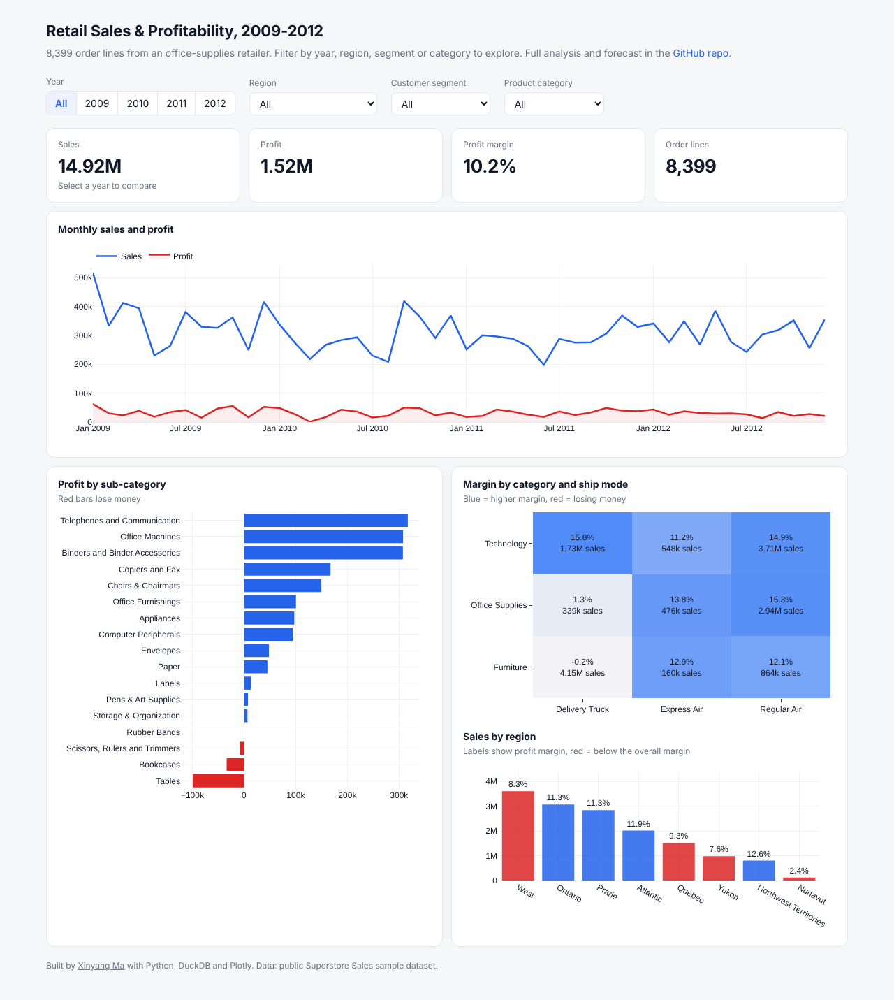
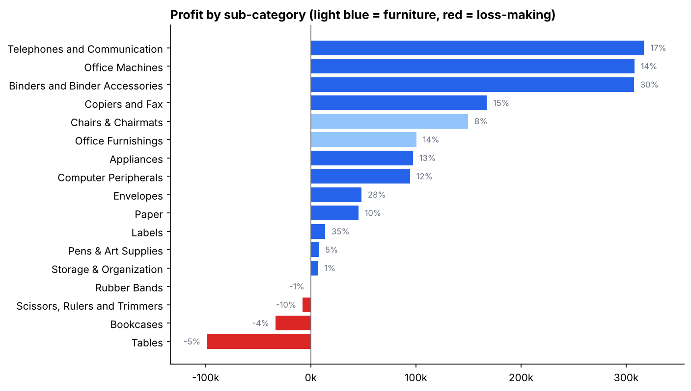
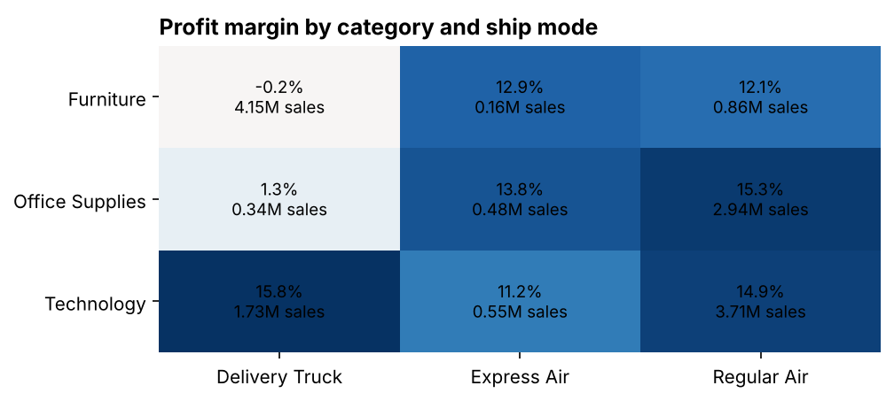
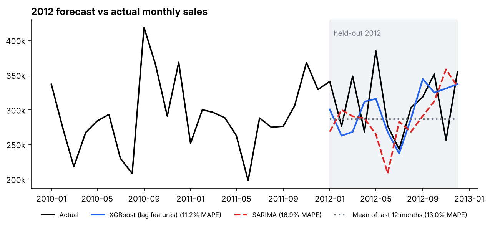

# Where does the profit go? Retail sales analysis and forecast

An end-to-end analysis of four years of sales at an office-supplies retailer: data quality checks, a SQL star schema, profitability deep-dive, a sales forecast tested against baselines, and an interactive dashboard.

**[Open the live dashboard](https://hakowxy.github.io/retail-sales-analytics/)** · **[Read the full analysis notebook](notebooks/analysis.ipynb)**

[](https://hakowxy.github.io/retail-sales-analytics/)

## Key findings

**1. Furniture is 35% of sales but only 8% of profit.** Its margin is 2.3%, against roughly 14-15% for Technology and Office Supplies. Tables and Bookcases lose money outright.



**2. The real leak is furniture shipped by delivery truck: 28% of all revenue at zero margin.** The same furniture shipped by air makes 12-13%. Truck shipments cost about 49 per order line in freight versus 13 by air, and the price doesn't cover it. Technology also ships by truck and still makes 16%, so the issue is bulky, low-price items, not the truck.



**3. Discounts make it worse but aren't the root cause.** Margin falls as discounts rise in every category, and furniture turns negative above 8% discount. But furniture is barely profitable even at 0-2% discount.

**4. The West is the biggest region but under-performs**, with an 8.3% margin against 10.2% overall. The gap comes from Technology, which makes 9% in the West versus 17-19% in most other regions.

**5. Revenue is not overly concentrated.** The top 20% of customers bring in 46% of sales.

## Forecast

I trained models on 2009-2011 and forecast every month of 2012 without seeing it:

| Model | MAPE on 2012 | Error on 2012 total |
|---|---|---|
| **XGBoost on lag features** | **11.2%** | −3.6% |
| Mean of last 12 months (baseline) | 13.0% | −7.6% |
| SARIMA (order chosen by AIC) | 16.9% | −6.9% |
| Seasonal naive (baseline) | 18.5% | −7.6% |



The series has almost no yearly seasonality (lag-12 autocorrelation 0.03), so SARIMA did worse than a flat average. XGBoost beat both baselines, and its full-year total was within 4%. That's good enough for quarterly planning but not for monthly targets, and the notebook says so.

## Recommendations

1. **Price freight into bulky furniture** with a truck-delivery surcharge or minimum order value. Bringing those orders to even an 8% margin would add about 340k profit, roughly +22% for the company.
2. **Review list prices for Tables and Bookcases**, which lose money at every discount level.
3. **Require approval for furniture discounts above 5%.**
4. **Look into Technology pricing and deal terms in the West.**
5. **Use the forecast for quarterly planning**, and add CRM pipeline data as the next improvement.

## What's in the repo

| Path | Contents |
|---|---|
| [`notebooks/analysis.ipynb`](notebooks/analysis.ipynb) | The full analysis: data quality, KPIs, profitability, forecasting, recommendations |
| [`sql/01_star_schema.sql`](sql/01_star_schema.sql) | Builds fact and dimension tables from the raw export (DuckDB) |
| [`sql/02_kpi_queries.sql`](sql/02_kpi_queries.sql) | KPI queries with CTEs and window functions (YoY growth, ranking, customer quintiles) |
| [`docs/`](docs) | The interactive dashboard (plain HTML + Plotly.js, hosted on GitHub Pages) |
| [`scripts/`](scripts) | Rebuilds the notebook and the dashboard data |
| [`data/superstore_sales.csv`](data/superstore_sales.csv) | Raw data |

## Run it yourself

```bash
pip install -r requirements.txt
jupyter nbconvert --to notebook --execute --inplace notebooks/analysis.ipynb
python scripts/build_dashboard_data.py
```

## About the data

This is the public *Superstore Sales* sample dataset (8,399 order lines, Canada, 2009-2012), from [curran/data](https://github.com/curran/data/tree/gh-pages/superstoreSales). I converted it to UTF-8 and otherwise left it unchanged. The currency and how profit is calculated aren't documented, so treat the numbers as relative. Customer names turned out not to be unique IDs, and the notebook explains how I handled that.

---

Made by [Xinyang Ma](https://github.com/hakowxy) · [LinkedIn](https://www.linkedin.com/in/xinyang-m-122844288/)
